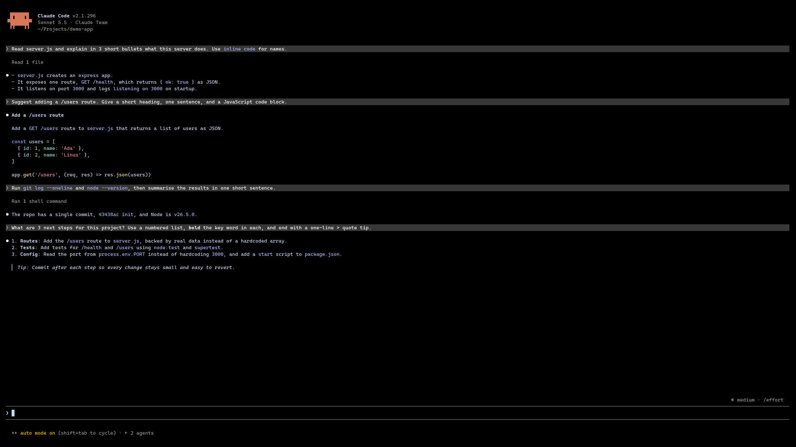
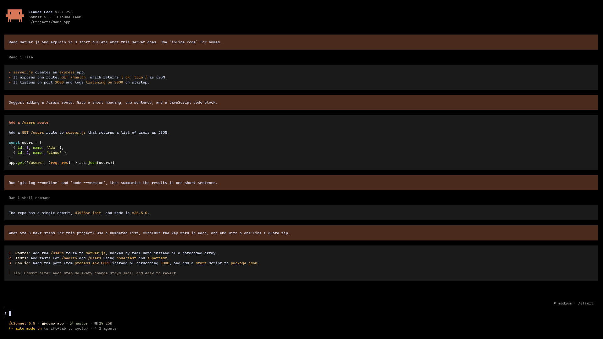
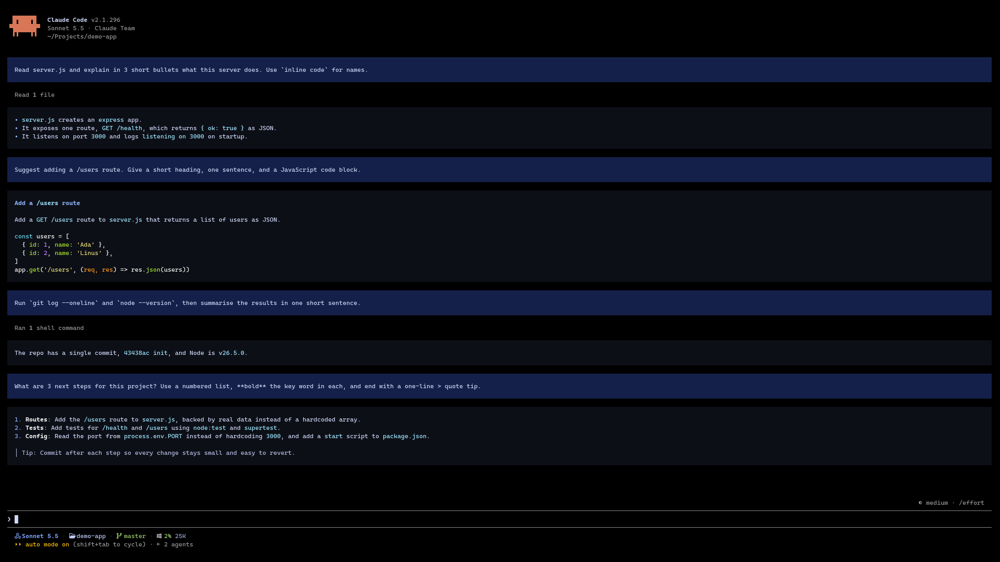

# ui-themes

Switchable themes for the Claude Code terminal UI:

- Your prompts and Claude's replies drawn in padded, coloured boxes (Claude Code's defaults have no reply box and little prompt padding; the plugin draws both itself)
- Reply markdown in theme colours (headings, `inline code`, **bold**, links, bullets, quotes)
- A matching one-line status line: model (own icon and colour for Opus, Sonnet, Haiku and Fable), folder, git branch, context, 5h/7d limits
- `/ui-theme` to pick a theme from a list and switch everything at once

## Before and after

<table>
  <tr>
    <th>Before: Claude Code default</th>
    <th>After: <code>claude-warm</code></th>
  </tr>
  <tr>
    <td></td>
    <td></td>
  </tr>
</table>

Replies get a padded charcoal box and themed markdown, prompts get a padded terracotta box, and the status line follows the theme.

<p align="center">
  <b>Also included: <code>night-blue</code></b>, one <code>/ui-theme next</code> away<br><br>
  
</p>

## Why I made this

I like coding agents like [Pi](https://pi.dev/), [OpenCode](https://opencode.ai) and [Oh My Pi](https://github.com/can1357/oh-my-pi). Their terminal UIs are clean, structured and light. Claude Code's felt messy and heavy next to them, and I didn't enjoy using it.

But I still use Claude Code. Claude's models are what I want to work with, and my Claude subscription only works through the Claude Code CLI, not through other harnesses. So I was stuck with a UI I didn't like.

When Claude Code added mods, I started tuning it to feel more like those agents: padded message boxes, readable markdown colours, a compact status line, and themes I can switch in one command. It isn't a copy of any of them, and it isn't finished, but it's already much nicer to live in every day.

If you're in the same spot, using Claude Code for the models while missing the feel of other agent CLIs, this plugin is for you.

Ships with three themes:

| Theme | Look |
|---|---|
| `claude-warm` (default) | Terracotta prompts, charcoal replies, Claude orange and honey text |
| `night-blue` | Navy prompts, near-black replies, bright blue and cyan text |
| `titanium` | Oh My Pi inspired: steel blue prompts, brushed titanium replies |

## Install

```
/plugin marketplace add yugal1107/ui-themes
/plugin install ui-themes@ui-themes
```

Restart Claude Code once after installing.

## Use

| Command | What it does |
|---|---|
| `/ui-theme` | Open a picker: arrow keys to choose, Enter to apply, Esc to close |
| `/ui-theme list` | Show the current theme and the available ones as text |
| `/ui-theme <name>` | Switch theme |
| `/ui-theme next` | Cycle to the next theme |
| `/ui-theme statusline` | Show how to enable the matching status line |
| `/ui-theme statusline update` | Apply a new status line script from a plugin update (your old copy is kept as `.bak`) |

### Status line

The status line is optional. Add this to `~/.claude/settings.json`:

```json
"statusLine": { "type": "command", "command": "bash ~/.claude/ui-themes/statusline.sh" }
```

It needs `jq`, and its icons need a [Nerd Font](https://www.nerdfonts.com/) in your terminal.

The script is copied to `~/.claude/ui-themes/statusline.sh` once and is never overwritten by plugin updates, because it runs with your permissions on every refresh. When an update ships a new version, you get a message at startup; run `/ui-theme statusline update` to apply it. Your edits to the script are kept until you do.

## Make your own theme

Themes live in `~/.claude/ui-themes/<name>.json` (the built-in ones are copied there on first start). On Windows that is `%USERPROFILE%\.claude\ui-themes`. Copy one, rename it and change the colours; it shows up in `/ui-theme` right away.

```json
{
  "name": "claude-warm",
  "prompt": { "bg": "#4a2a1c" },
  "reply": { "bg": "#1a1a1a" },
  "markdown": {
    "code": "#e0a458", "bold": "#f5e6d3", "heading": "#d97757", "link": "#d97757",
    "bullet": "#d97757", "quote": "#a8998a", "rule": "#3a3029"
  },
  "statusline": {
    "model": "#d97757", "modelOpus": "#d97757", "modelSonnet": "#e0a458",
    "modelHaiku": "#a3b18a", "modelFable": "#c49bbb", "dir": "#f5e6d3", "git": "#a3b18a", "dirty": "#e0a458",
    "label": "#a8998a", "muted": "#8a7b6e", "ok": "#a3b18a", "warn": "#e0a458",
    "hot": "#e5534b", "sep": "#5c4a3d"
  }
}
```

## Notes

- Built on Claude Code's function-hook plugin API, which is in early access and may change between releases.
- Code blocks and tables keep Claude Code's own rendering.
- While a reply is still streaming, Claude Code draws it with its own view; it moves into the coloured box once the block finishes.
- `/theme` is Claude Code's own command and is left untouched; this plugin uses `/ui-theme`.

## License

[MIT](LICENSE) © 2026 Yugal Burde
